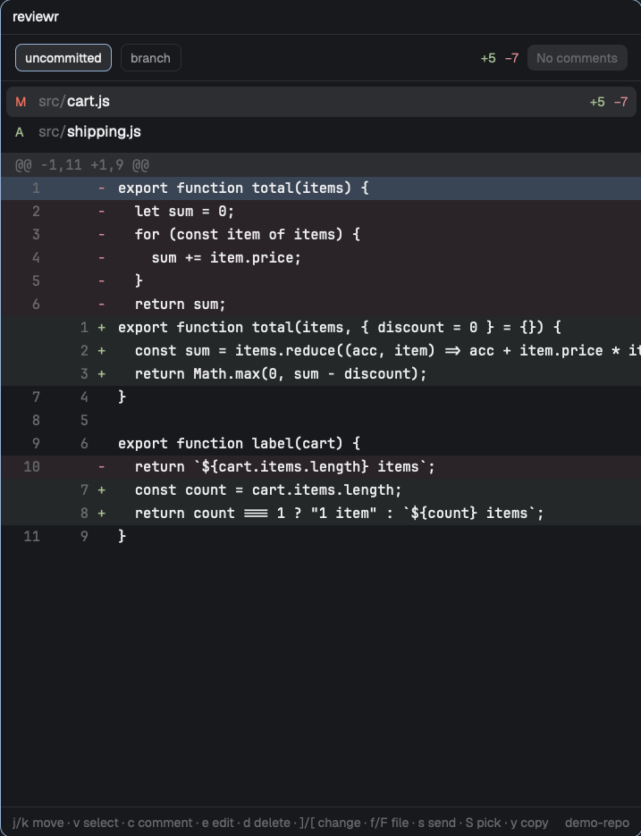

# reviewr for the Herdr app

A code-review pane for the [Herdr app](https://herdr.dev). Read your agent's diff beside the chat, comment on lines, and paste the comments into the agent's input.



## Inspired by herdr-reviewr

This mod is inspired by [herdr-reviewr](https://github.com/persiyanov/herdr-reviewr), Dmitry Persiyanov's plugin for the Herdr TUI. That plugin is a Rust terminal program, and it sends comments through the Herdr TUI socket, which the Herdr app doesn't have. This mod is a separate rewrite for the Herdr app as a native mod (gpui-kit JavaScript), with no code copied from the original. The key bindings and the format of the review it sends follow herdr-reviewr. If you use the Herdr TUI, use the original plugin.

## Install

Tell your agent:

```
Read ~/.config/herdr-app/AGENTS.md, then add this mod: herdr.dev/mods/jacksonpires/herdr-app-reviewr
```

Or by hand: copy `mods/reviewr/` to `~/.config/herdr-app/mods/reviewr/` and merge `keys.json` into `~/.config/herdr-app/keys.json`.

## Use

- `cmd-alt-r` opens reviewr to the right of the focused terminal, on that terminal's repository, and closes it when it is already open in the tab. `q` closes it too. Unsent comments are kept for the next time.
- `u` / `b`: uncommitted changes, or the whole branch against `origin/main` (or the repository's default branch). reviewr remembers the last scope you picked and opens in it next time.
- `j` / `k` move, `]` / `[` jump between changes, `f` / `F` switch files.
- `v` selects a range, `c` comments, `e` edits, `d` deletes. Double-click a line to comment on it.
- `l` lists every comment: `j` / `k` move, `Enter` goes to the comment in the diff, `e` edits, `d` deletes, `s` sends them all, `y` copies, `l` or `Esc` closes.
- `s` pastes every comment into the agent's input without pressing Enter, so you can read it first. `S` lets you pick the agent. `y` copies the review.
- `n` / `N` jump to the next or previous comment, `Ctrl+U` / `Ctrl+D` move half a page, `B` picks the base of the branch scope, `w` wraps long lines, `z` hides the file list, `o` opens the branch's pull request (needs `gh`), `Q` closes and drops unsent comments, `?` shows every key.
- Any key can be rebound from `keys.json` with `reviewr.key-<key>`, e.g. `"mod:reviewr": { "ctrl-n": "reviewr.key-n" }`.

Sending uses the clipboard and moves the keyboard to the agent's pane.

Not included, compared with herdr-reviewr: the last-turn scope, the commits scope (`g`, `G`), the All files and PR tabs (`1`, `2`, `3`), worktree switch (`W`), search (`/`, `Ctrl+F`), go to line (`:`), sideways scroll (`←`, `→`), rendered markdown (`m`), split view (`|`), moving and resizing the file list (`p`, `<`, `>`) and `Tab` between list and diff.

`RECIPE.md` describes the whole mod, so an agent can rebuild it from scratch.

## License

MIT
