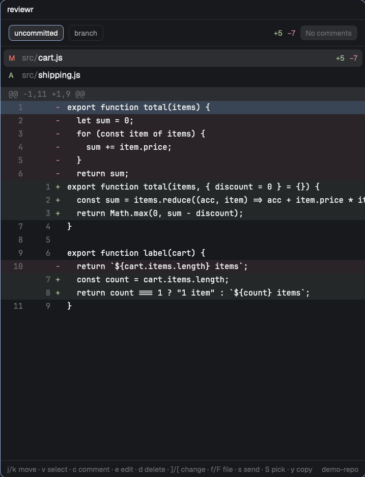

# reviewr

A code-review pane beside your agent. It lists the files the agent changed, shows each diff with old and new line numbers, lets you comment on a line or a range, and pastes every comment into the agent's input in one go, for you to read and send. A native Herdr app port of [herdr-reviewr](https://github.com/persiyanov/herdr-reviewr) by Dmitry Persiyanov, which does the same for the Herdr TUI.

## What you see

A pane, opened to the right of the focused terminal. Top to bottom:

- **A 40px bar** with two scope pills, `uncommitted` and `branch` (11px text, 6px radius; the active one has the `selected` background and an `accent` border, and the branch pill reads `branch · origin/main` once it found the base). On the right, the total added lines in `ansi2`, the removed lines in `ansi1`, and a button: `Send 3 comments` on `solid`, or a dim `No comments`.
- **The file list**, 26px rows, up to 8 visible before it scrolls. Each row: a status letter (`A` in `ansi2` for an untracked file, `M` in the `blocked` color otherwise, `D` when it only removes lines), the folder dimmed and the file name in the foreground, `◆2` in `accent` when it has comments, then `+n` and `−n`. The open file has the `selected` background.
- **The diff**, in the terminal font at 12px, 20px rows: old line number, new line number (34px each, right aligned, dim), the `+` or `-` marker, then the line, never wrapped (it scrolls sideways). Added lines on `ansi2` at 9% alpha, removed lines on `ansi1` at 9%, hunk headers on `raised` in dim text. The cursor and a selected range use the theme's `selection` color. A comment shows as its own row right under the last line it covers: `◆` in `accent` and its text on one line, on `accent` at 13%.
- **A 26px footer** with the keys for the current state on the left and the repository name on the right. Errors and confirmations (`Copied 2 comments`) take the left side, errors in `ansi1`.
- With `l`, a panel above the footer lists the comments, sorted by file and line, up to nine at a time around the selected one: the location in `accent` at 11px, the comment on one line under it, the selected one on `selected`. Its title reads `Comments · 3`.
- While writing a comment, a panel above the footer shows the location (`src/cart.js:3-5`) and a one-line input with an `accent` border. While picking an agent, a panel lists up to nine agents: number, program name, `space · tab · title`, and its status in that status's color.

## How it behaves

- It reviews the repository of a terminal in the tab it was opened from: an agent's pane first, else the focused terminal, else the first one. `props.folder` overrides that; `props.scope: "branch"` starts in the branch scope.
- **uncommitted** diffs the working tree against `HEAD`, untracked files included as all-added. **branch** diffs the working tree against the merge base of `HEAD` and `origin/HEAD` (else `origin/main`, `origin/master`, `main`, `master`), so it covers the branch's commits and what is not committed yet.
- It refreshes when anything in the repository changes (a folder watch) and every 15 seconds, keeping the cursor on the same line when it still exists.
- Click a file to open it. Click a line to put the cursor there, Shift-click to select a range, double-click to comment on it.
- Keys, while the pane has the keyboard: `j`/`k` or arrows move, `PageUp`/`PageDown` move 20 lines, `]`/`[` jump to the next or previous change, `f`/`F` next or previous file, `v` starts or ends a range, `c` comments on the cursor line or the range (an existing comment on the same lines opens for editing), `e` edits the comment under the cursor, `d` deletes it, `l` lists the comments, `q` closes the pane, `s` sends, `S` picks the agent first, `y` copies the review, `u`/`b` switch scope, `r` finds the repository again and refreshes, `Esc` clears the range or the message.
- `l` opens and closes the comments list, as in herdr-reviewr. In it: `j`/`k` or arrows move, `Enter` (or a double-click) opens the comment's file and puts the cursor on its last line, `e` edits the selected comment (the list comes back after saving), `d` deletes it (the list closes when none are left), `s` sends all comments, `S` picks the agent first, `y` copies, `l` or `Esc` closes. With no comments, `l` shows `No comments yet`.
- `cmd-alt-r` opens reviewr beside the focused pane, or closes it when the tab already has one; the keyboard goes back to the pane that had it.
- In the comment input, `Enter` saves and `Esc` cancels. An empty comment saves nothing.
- **Send** goes to the only agent in the tab; with none in the tab, to the only agent in the space; otherwise the picker opens (`1`–`9` or a click, `Esc` cancels). It puts the review on the clipboard, focuses the agent's pane and pastes it, without pressing Enter, so you can read it and add to it. A toast says `Sent 3 comments`. The comments are then cleared.
- The review text is `Worktree: <repo root>`, then one block per comment sorted by file and line, separated by a blank line: the location (`src/cart.js:3-5`, with ` (removed)` when the comment is only on removed lines, using the old numbers), the diff lines it covers with their `+`/`-`/space markers, and the comment without blank lines.
- Comments survive a restart: they are kept per repository in the pane's `localStorage`.
- No agent-status displays and no animations.

## Built from

- One mod, `mods/reviewr/`, with `main.js` and `mod.json` (`{"place": "none", "focusable": true, "overlay": {"kind": "popup", "width": 1, "height": 1}}`), and a `keys.json` with one global binding, merged into the person's keys: `cmd-alt-r` runs `mod.open:reviewr`.
- The toggle: a copy opened by `mod.open` has `props().overlay`. It draws nothing, closes its overlay at once with `closeOverlay`, then runs `pane.close` on every reviewr pane in the focused tab, or, when there is none, `pane.split {direction: "right", mod: "reviewr", pane: <focused pane>}`. `q` in the pane runs `pane.close` on the focused reviewr pane.
- `gpui-kit` (`View`, `div`) and `gpui-base` (`v_flex`, `h_flex`, `InputState`, `Input`, `Scrollbar`, `ScrollHandle`). The diff is a plain `overflow_scroll()` area with every row as a child and a `ScrollHandle` that keeps the cursor on screen; it caps a file at 1,500 lines.
- `herdr`: `spaces()`, `panes()`, `agents()`, `focused()`, `props()`, `theme()`, `settings()` (`font_family` for the diff), `exec`, `readTextFile`, `watchFolder`, `run`, `notify`, `nextCommand`, `checking`.
- Commands: `pane.focus {terminal}` and `terminal.paste` for Send, through `cx.write_to_clipboard`. Mod commands `reviewr.send` and `reviewr.refresh` can be bound in a `mod:reviewr` section.
- Programs: `git` only (`rev-parse`, `merge-base`, `diff --numstat`, `diff`, `status --porcelain`), always with `--no-optional-locks -c core.fsmonitor=false -c diff.autoRefreshIndex=false` so a read never touches `.git` and wakes the folder watch. Spaces on another machine run git there (`exec` with `on`); the folder watch is local only.

## Watch out

- `v_virtual_list` drew nothing here inside a `flex_1` column, even with an explicit height. The plain scroll area works; keep the line cap.
- Sending overwrites the clipboard and moves the keyboard to the agent's pane. That is what lets the text land in the agent's input without Enter; `hc send` would submit it.
- Untracked files are read whole and cut at 1,500 lines; binary files show `Binary file`.
- Lines over 2,000 characters are cut with `…`.
- Don't name a method `close` on the `View`: Herdr calls `close(cx)` when the pane goes, so a `close` that runs `pane.close` loops.
- There is no last-turn scope, PR tab, file search or split view, which the TUI plugin has.
- Opening it from a tab with no terminal in a git repository shows the reason in the footer; `r` tries again.
- `cmd-alt-r` is free in Herdr's default keys on macOS. On Linux and Windows `cmd` is the Super key; pick another chord if it clashes.

## Done when

- `herdr-app check mods/reviewr` passes.
- In a repository with uncommitted changes, `cmd-alt-r` opens the pane on the right with the changed files and the first file's diff, numbered as `git diff` numbers it.
- A second `cmd-alt-r` closes the pane, and `q` inside it closes it too; reopening shows the unsent comments again.
- `b` shows the branch scope against `origin/main` (or the repository's default), including committed work; `u` goes back.
- Selecting three lines with `v` and `j`, then `c`, typing and `Enter` shows the comment row under the third line and `◆1` on the file.
- `l` lists every comment; `Enter` on one in another file opens that file with the cursor on it; `d` there removes it from the list and the diff.
- `s` with one agent in the tab pastes the review into its input, without submitting, in the format above; the comments are gone afterwards.
- With two agents in the tab, `s` opens the picker and `2` sends to the second.
- Editing a file in the repository updates the list and the diff within a second or two.
